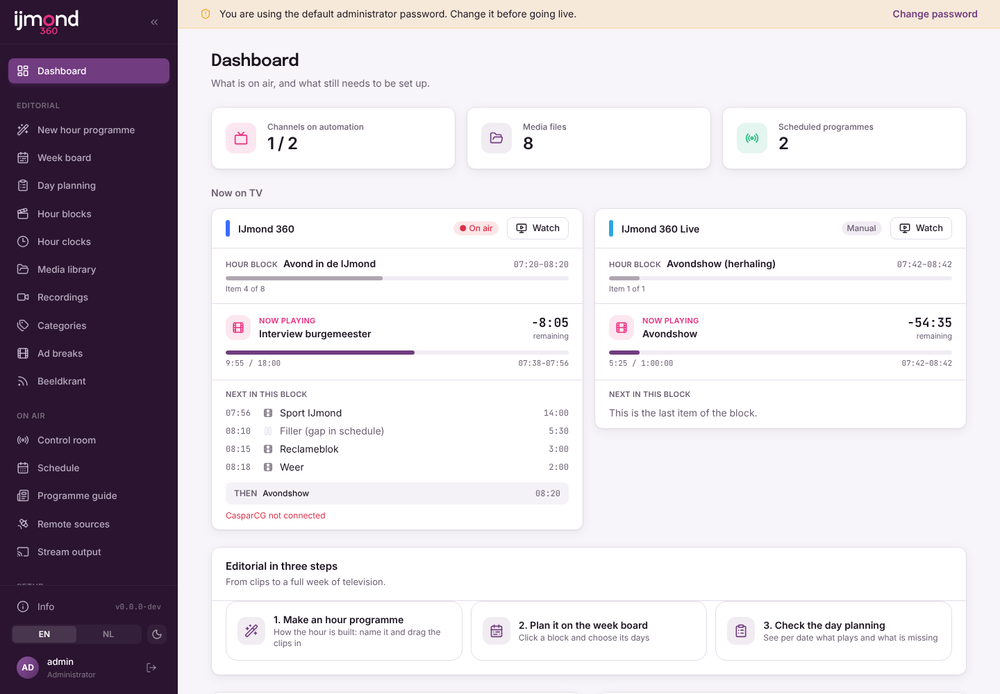
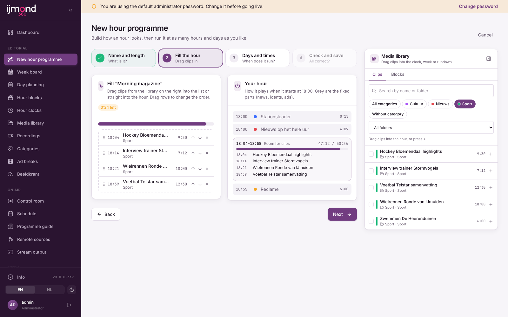
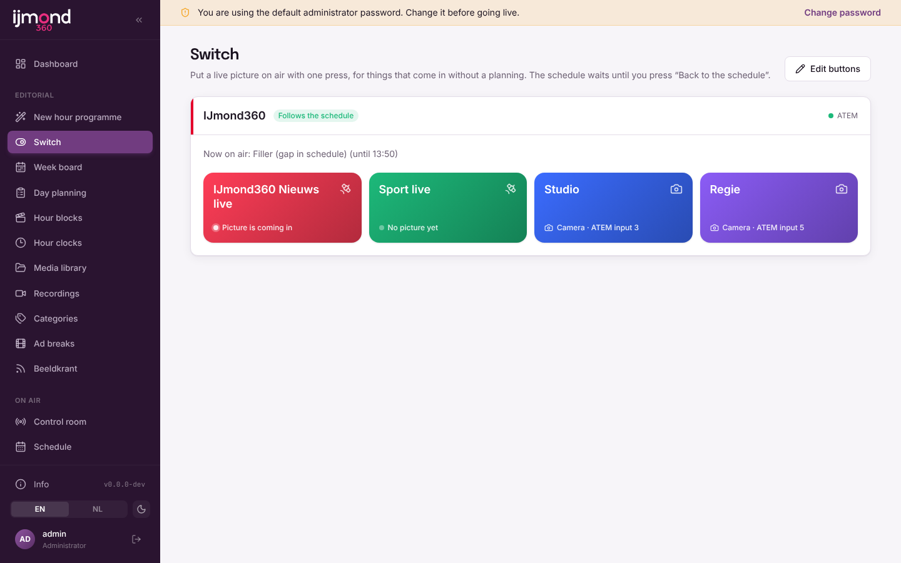
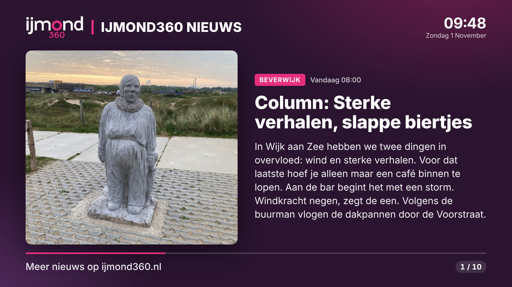
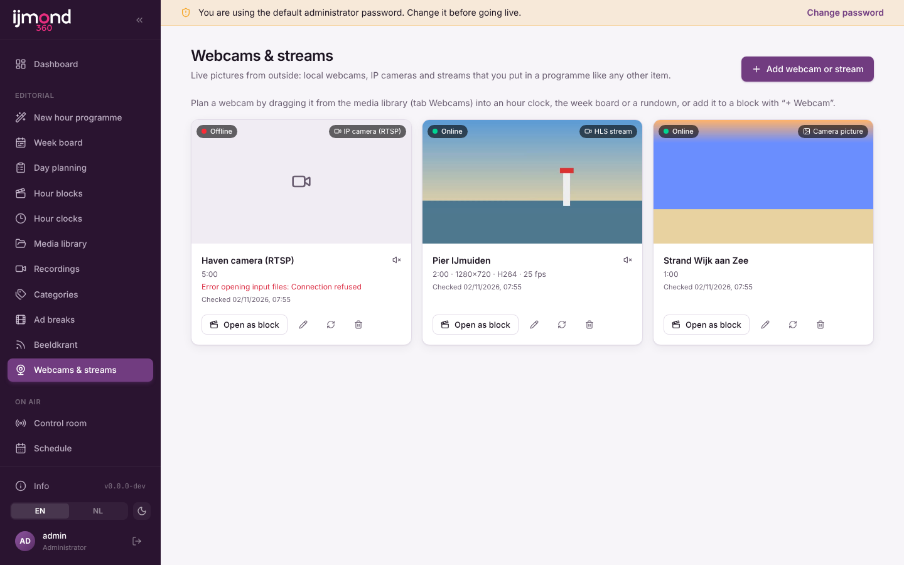
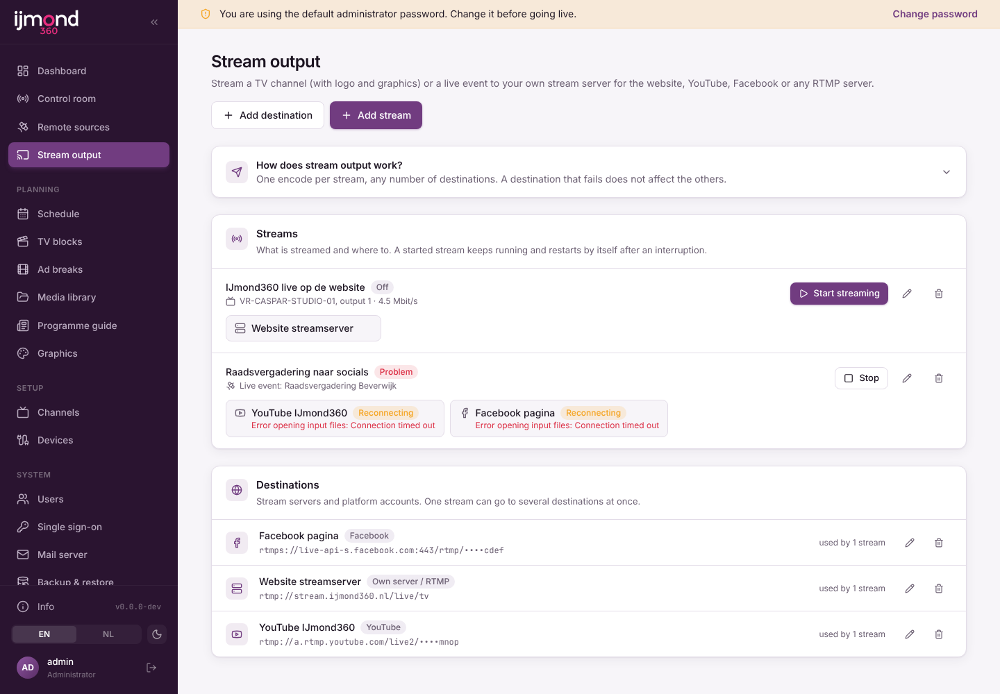
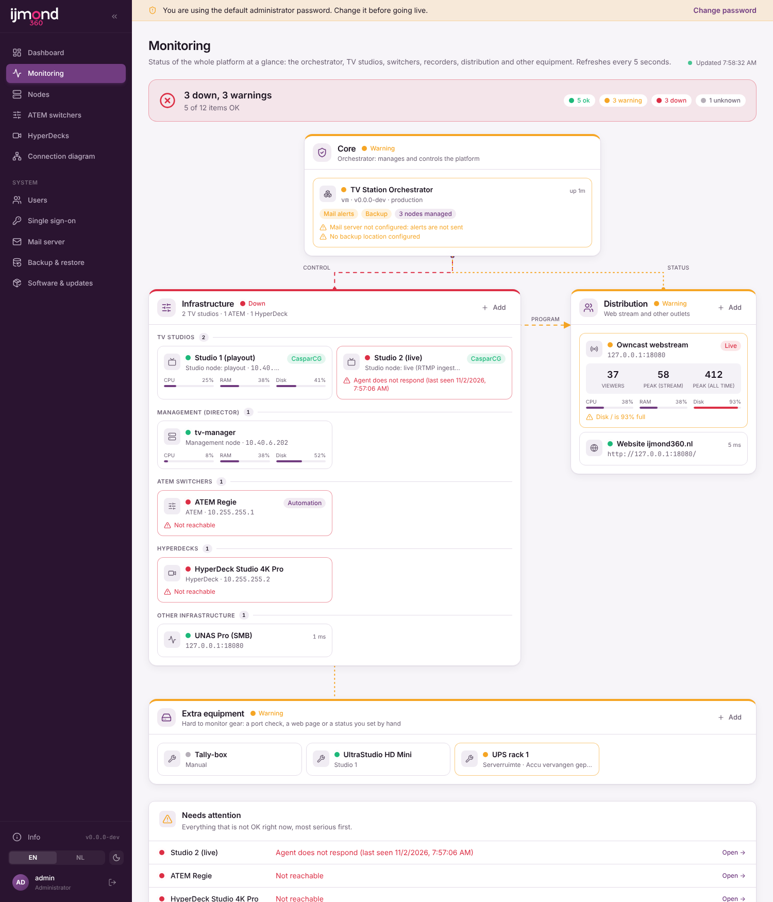
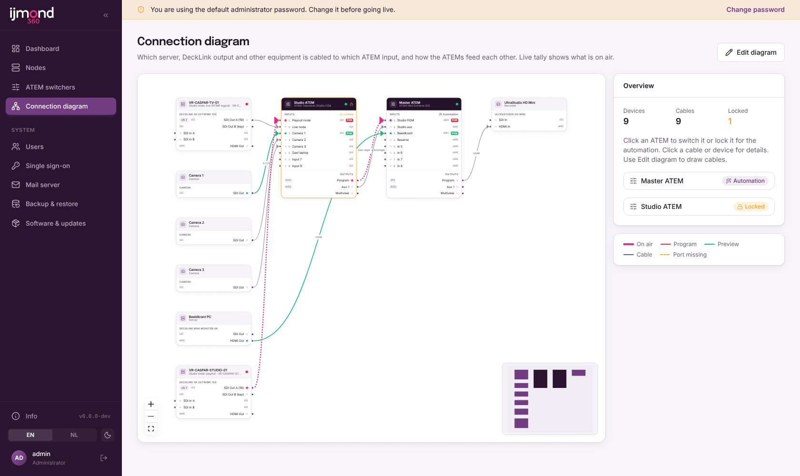
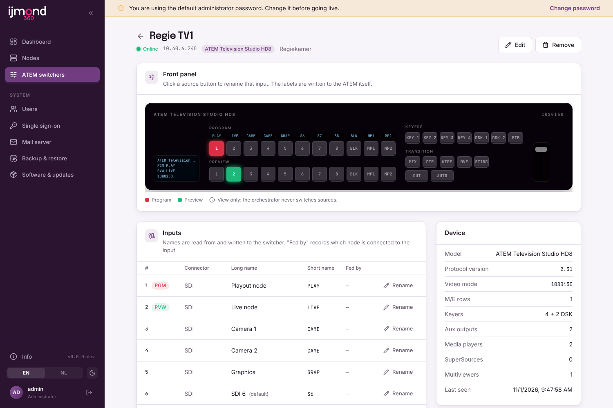
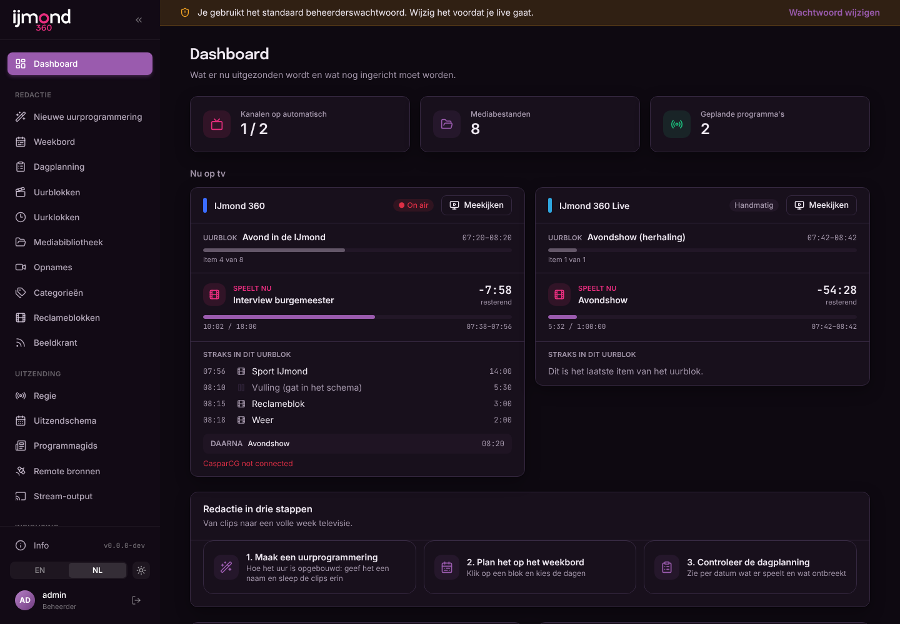

# TV Station Manager

[Nederlands](README.nl.md)

Platform for running automated TV channels:

| Part | Runs on | Role |
|---|---|---|
| **Orchestrator** | Debian 13 | Enrolls nodes, assigns roles, monitors them and rolls out updates |
| **Management node** | Debian 13 | The director: schedule, EPG, ad breaks, media from the UNAS, ATEM switching |
| **Studio node** | Windows + DeckLink | Playout over SDI with graphics overlay and RTMP input |

Every app has the same base: a left-hand admin menu, English and Dutch, an Info button with the version and update check, updates from the UI with a production/test channel switch, a configurable SMTP mail server, and full/incremental backups to FTP, FTPS or SCP with restore.

## Install (Debian 13)

```bash
curl -fsSL https://raw.githubusercontent.com/rhisijmuiden/tv-station-manager/production/packaging/install.sh | sudo bash -s -- orchestrator
# test channel:
curl -fsSL https://raw.githubusercontent.com/rhisijmuiden/tv-station-manager/production/packaging/install.sh | sudo bash -s -- orchestrator --channel test
```

Management node (registers itself with the orchestrator through the agent):

```bash
curl -fsSL https://raw.githubusercontent.com/rhisijmuiden/tv-station-manager/production/packaging/install.sh | sudo bash -s -- management --channel test --orchestrator http://10.40.6.201:8080
```

Then open `http://<server>:8080` and sign in with **admin / admin**. The UI shows a warning until you change that password (My account). Set `TVSM_DEFAULT_ADMIN=user:password` or `off` in `/etc/tvsm/<app>/env` before the first start to change this.

## Screenshots

| | |
|---|---|
|  |  |
| **Management: dashboard.** What is on air per channel, the hour block, progress and what comes next. | **Management: new hour programme.** Name the hour, drag clips in, plan it on several days and times. |
|  |  |
| **Management: switch.** One press puts an unplanned live feed or camera on air. | **Beeldkrant.** Full-screen news pages from the WordPress RSS feed. |
|  |  |
| **Management: webcams and streams** as programme items. | **Management: stream output** to an own server, YouTube, Facebook or Twitch. |
|  |  |
| **Orchestrator: monitoring.** The whole platform at a glance, with what needs attention. | **Orchestrator: connection diagram.** Which output is cabled to which ATEM input, with live tally. |
|  |  |
| **Orchestrator: ATEM switchers**, any model, with a front-panel view. | **English and Dutch, light and dark** in every app. |

## Management node

The director of the station. Sign in as editor-in-chief (role *Editor-in-chief*) to plan, or as *Operator* for the control room only. The menu has three groups.

**Editorial**

| Menu | What it does |
|---|---|
| New hour programme | Step-by-step wizard: name and length, drag clips in, choose days and start times, check and save. See [docs/week-schedule.md](docs/week-schedule.md) ([NL](docs/week-schedule.nl.md)) |
| Switch | Big buttons that put an unplanned live feed or camera on air, optionally recorded and repeated. See [docs/switching.md](docs/switching.md) ([NL](docs/switching.nl.md)) |
| Week board / Day planning | Plan hour blocks across the week; the week schedule fills the next 14 days. Manual entries always win |
| Hour blocks / Hour clocks / Categories / Ad breaks | Reusable rundowns, the fixed layout of every hour (news, idents, ads) and content categories. The logo is hidden during ads |
| Media library | Files on the UniFi UNAS Pro over SMB (`smbclient`), rescanned every 15 minutes, durations measured with ffprobe. Drag clips straight into clocks, the week board and rundowns |
| Recordings | Incoming live streams are recorded, trimmed and put in the library or planned as a repeat. See [docs/recordings.md](docs/recordings.md) ([NL](docs/recordings.nl.md)) |
| Beeldkrant | Full-screen news pages from WordPress or any RSS/Atom feed, played by CasparCG. See [docs/beeldkrant.md](docs/beeldkrant.md) ([NL](docs/beeldkrant.nl.md)) |
| Webcams & streams | HLS, RTSP, RTMP, SRT, MJPEG or a web page as a programme item. See [docs/webcams.md](docs/webcams.md) ([NL](docs/webcams.nl.md)) |

**On air**

| Menu | What it does |
|---|---|
| Control room | Per channel: now/next with countdown, automation on/off, ATEM program/preview/cut/auto, take a live source and go back to the schedule, as-run log |
| Schedule | The resulting day schedule per channel. Entries start exactly on time; gaps play the filler clip or the fallback ATEM input |
| Programme guide | EPG grid and a token protected XMLTV feed (`/epg/xmltv.xml?token=…`) |
| Remote sources | RTMP/SRT streams from outside (OBS, vMix, a phone) with a stream key per source, sent to a DeckLink output. See [docs/remote-sources.md](docs/remote-sources.md) ([NL](docs/remote-sources.nl.md)) |
| Audio | Audio under the broadcast (radio stream or a physical input) per block, item or beeldkrant. See [docs/audio.md](docs/audio.md) ([NL](docs/audio.nl.md)) |
| Stream output | The channel over RTMP(S) to an own server, YouTube, Facebook or Twitch. See [docs/stream-output.md](docs/stream-output.md) ([NL](docs/stream-output.nl.md)) |

**Setup**

| Menu | What it does |
|---|---|
| Graphics | Per channel logo, clock, up-next bar, subtitles and a news ticker (fixed text or scrolling RSS headlines, speed/size/colours adjustable, see [docs/ticker.md](docs/ticker.md)) with a live preview, rendered by the CasparCG template `studio/casparcg-templates/tvsm/overlay.html` |
| Channels / Devices | ATEM switchers (any model), studio nodes (CasparCG AMCP, port 5250) with a playout or live role, live sources and the per-channel wiring. See [docs/two-nodes.md](docs/two-nodes.md) ([NL](docs/two-nodes.nl.md)) |
| Switch buttons | Set up the buttons on the Switch page: name, colour and live source per channel |

## Orchestrator

| Menu | What it does |
|---|---|
| Monitoring | Status of nodes, ATEMs, Teranex converters, stream servers and extra equipment in one block diagram. See [docs/monitoring.md](docs/monitoring.md) |
| Nodes | Approve nodes that registered through the agent and give them a role (management, playout, live) |
| ATEM switchers | Inventory with front-panel view, input names and manual switching. See [docs/atem-inventory.md](docs/atem-inventory.md) |
| Teranex | Read-only status of Teranex converters: input, format, audio, output, signal loss alerts. See [docs/teranex.md](docs/teranex.md) ([NL](docs/teranex.nl.md)) |
| Connection diagram | Devices, DeckLink cards and cables to the ATEM inputs, with live tally and an automation lock per ATEM. See [docs/connection-diagram.md](docs/connection-diagram.md) ([NL](docs/connection-diagram.nl.md)) |

How it plays out: for every channel the management node tells CasparCG on the studio node to play the clip
(`PLAY <channel>-10 "Folder/Clip"`, the next clip is preloaded with `LOADBG`), switches the ATEM to the input the studio
node output is cabled to, and updates the overlay with `CG UPDATE`. See [studio/README.md](studio/README.md) for the
CasparCG side.

### Behind a reverse proxy

The apps trust `X-Forwarded-*` headers, so the session cookie is marked `Secure` when the proxy terminates HTTPS. Example for nginx:

```nginx
location / {
    proxy_pass http://<orchestrator-ip>:8080;
    proxy_set_header Host $host;
    proxy_set_header X-Forwarded-For $proxy_add_x_forwarded_for;
    proxy_set_header X-Forwarded-Proto $scheme;
    proxy_http_version 1.1;
    proxy_set_header Upgrade $http_upgrade;
    proxy_set_header Connection "upgrade";
}
```

Only expose the proxy, not port 8080 directly.

### Sign in with Office 365

**System → Single sign-on** lets people sign in with their Microsoft Entra ID (Office 365) account; local accounts keep
working as a fallback. See [docs/sso.md](docs/sso.md) ([NL](docs/sso.nl.md)) for the app registration.

## Development

```bash
pnpm install
pnpm dev:orchestrator   # API on :8080, UI on http://localhost:5173
pnpm dev:management     # API on :8081, UI on http://localhost:5174
pnpm typecheck && pnpm test
```

## Branches and releases

- `test`: pre-releases (`v0.2.0-test.<n>`), installed by apps on the **test** channel.
- `production`: stable releases (`v0.2.0`), installed by apps on the **production** channel.

Work goes into a feature branch, then a PR into `test`, then `test` is merged into `production`.

## House style

See [branding/README.md](branding/README.md): every house style lives in its own folder, `branding/active-brand` selects the one the apps are built with.

## License

TV Station Manager is free software, licensed under the
[GNU Affero General Public License v3.0](LICENSE) (`AGPL-3.0-only`).

- You may use, study, change and share it. If you distribute it, or let people use a **modified** version over a
  network (for example the web interface), you must offer them the complete source code of that version under the
  same license.
- The Info dialog in every app shows the license and links to the source code of the running version.
- The `.deb` packages carry the license in `/usr/share/doc/tvsm-<app>/` (`copyright`, `LICENSE`); the Windows
  agent zip carries `LICENSE.txt`.

Third-party components keep their own licenses. All bundled npm dependencies use licenses compatible with
AGPL-3.0 (MIT, ISC, BSD, Apache-2.0, BlueOak-1.0.0, 0BSD, MIT-0, Unlicense; fonts under OFL-1.1). Programs that run
next to TVSM as separate processes are not part of this work: Node.js (MIT, bundled), WinSW (MIT), MediaMTX (MIT),
CasparCG Server (GPL-3.0) and FFmpeg/smbclient (installed from Debian).
