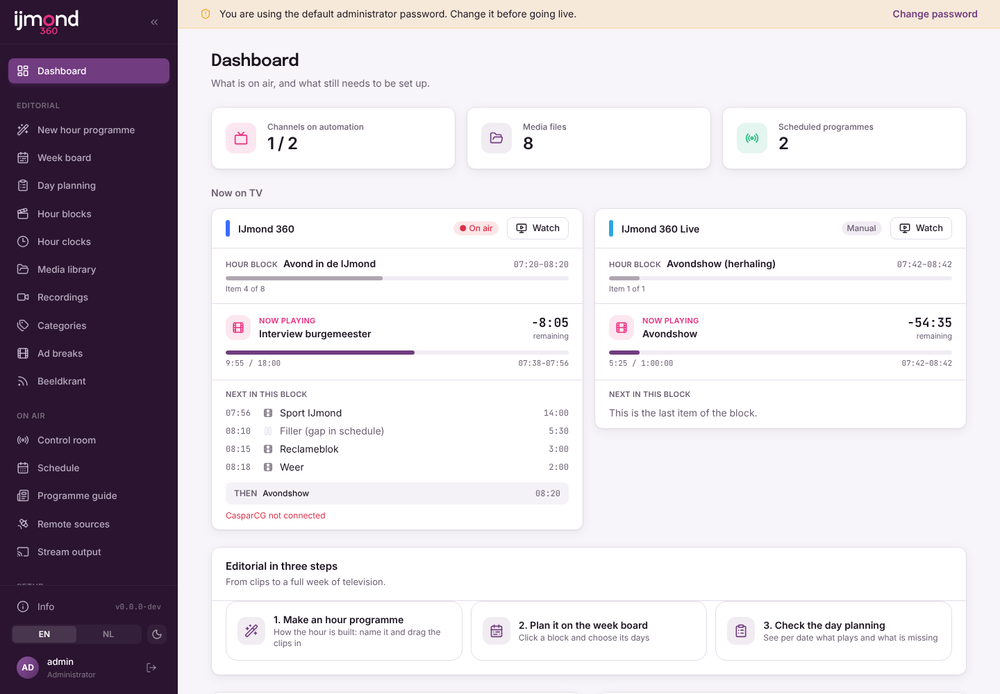
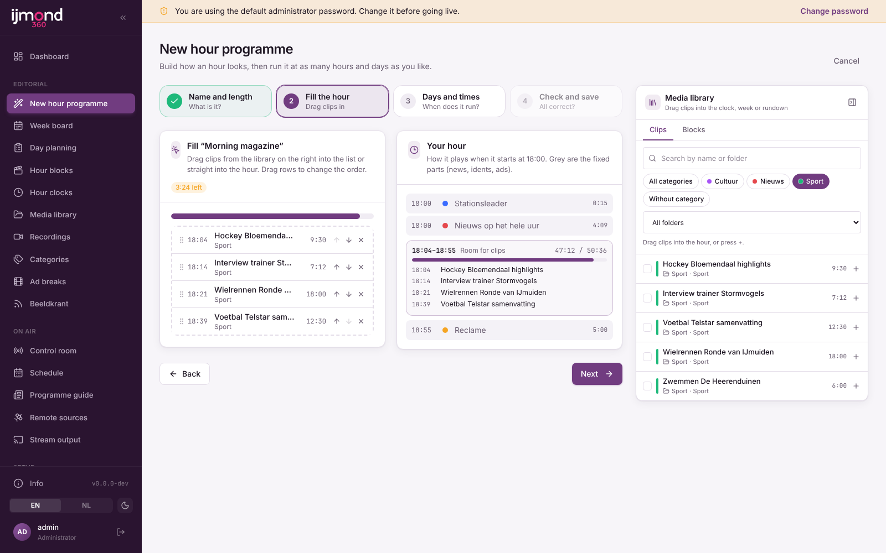
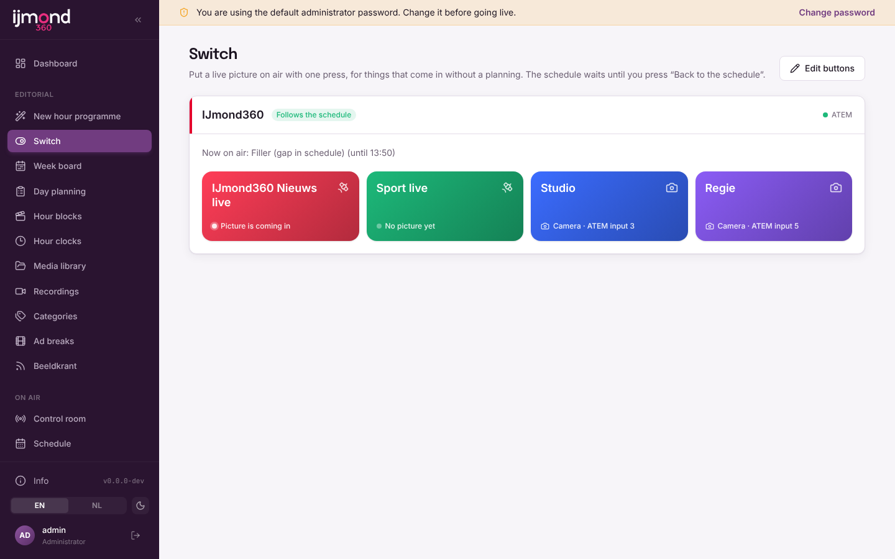
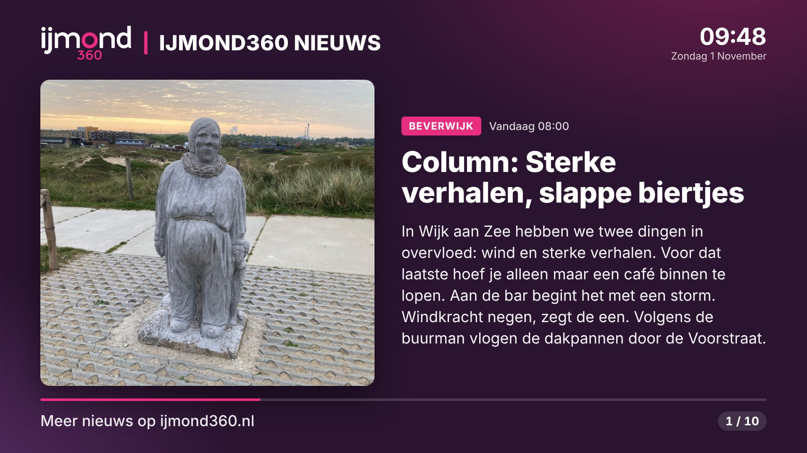
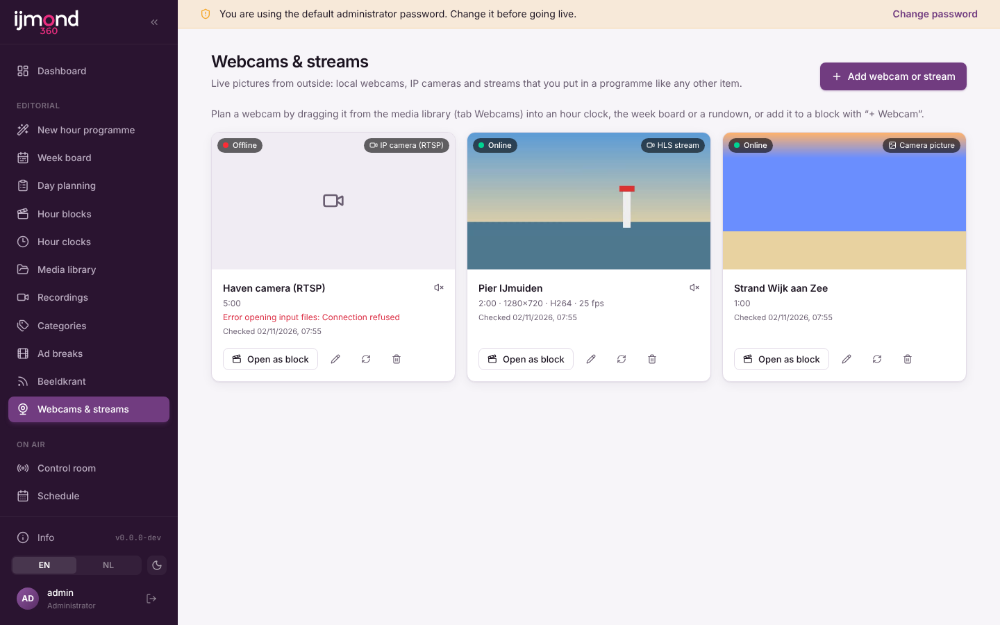
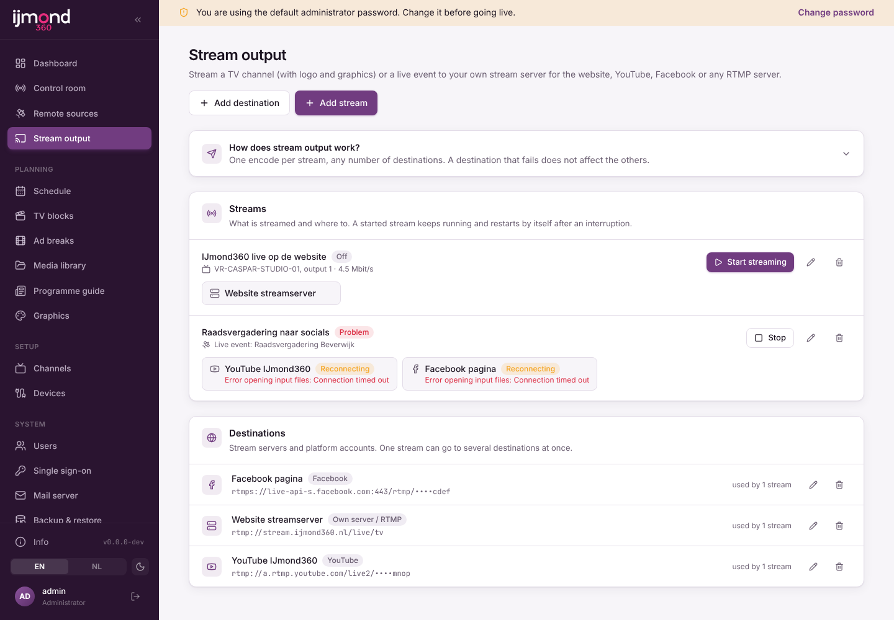
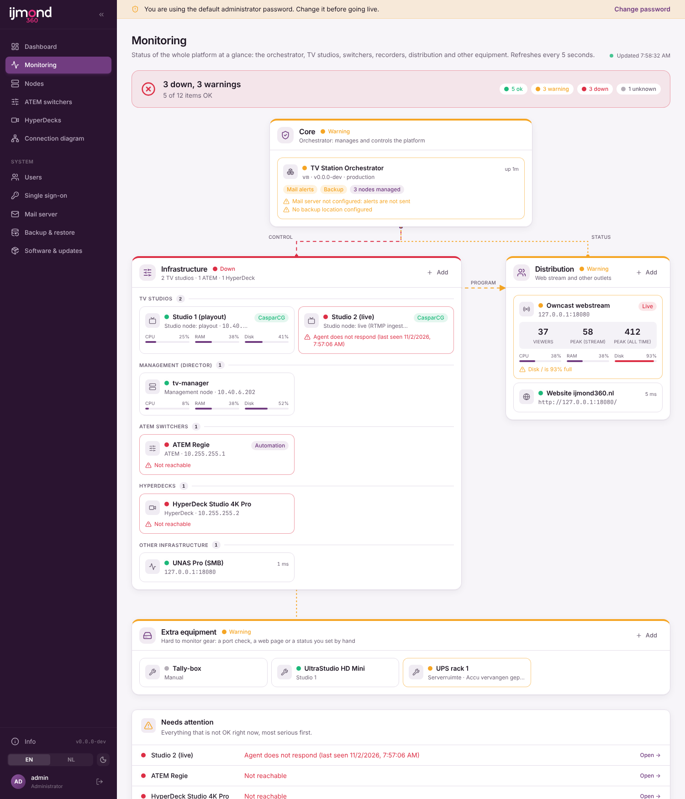
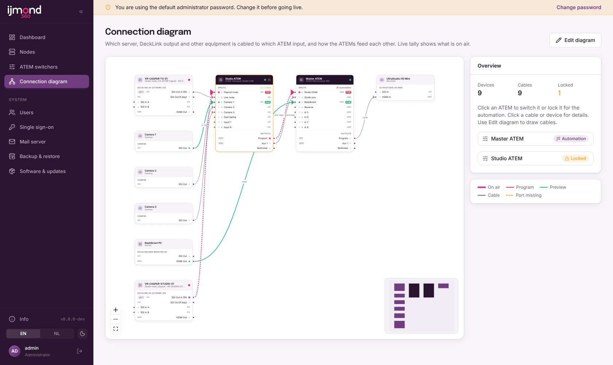
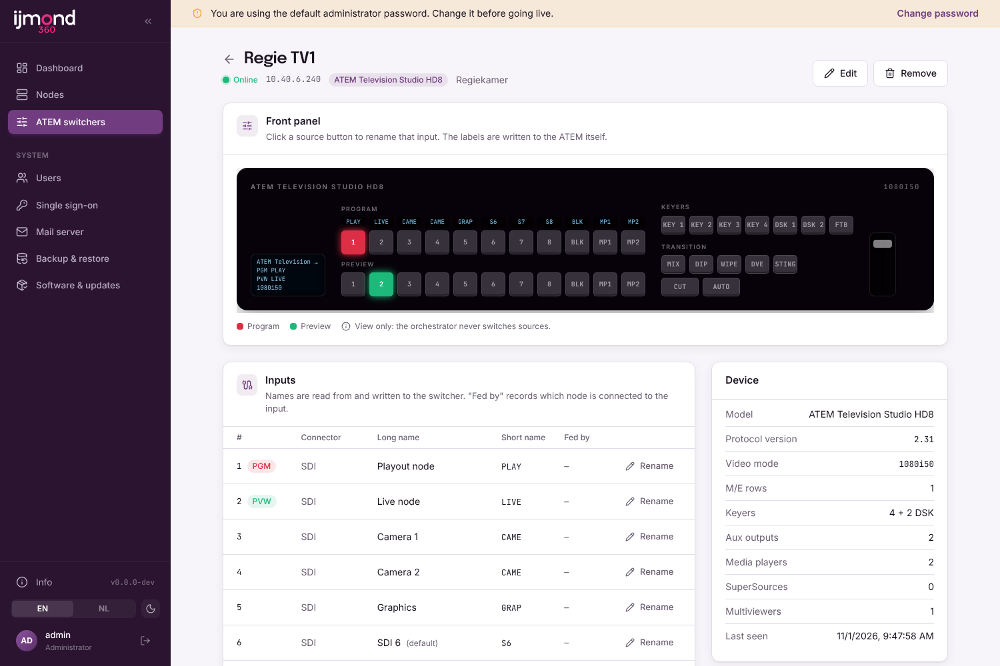
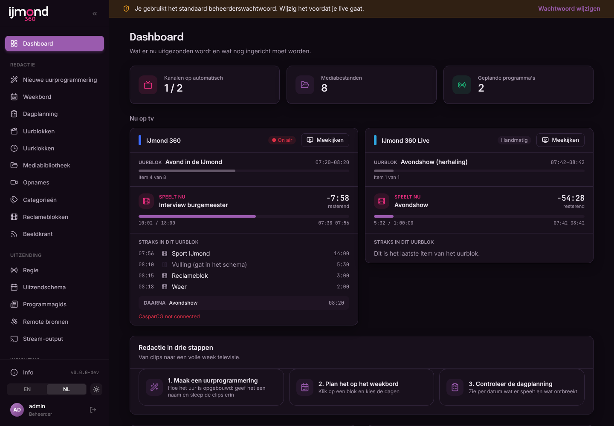

# TV Station Manager

[English](README.md)

Platform om geautomatiseerde tv-kanalen te draaien:

| Onderdeel | Draait op | Rol |
|---|---|---|
| **Orchestrator** | Debian 13 | Meldt nodes aan, geeft ze een rol, bewaakt ze en rolt updates uit |
| **Management node** | Debian 13 | De regisseur: schema, EPG, reclameblokken, media van de UNAS, ATEM schakelen |
| **Studio node** | Windows + DeckLink | Playout over SDI met graphics en RTMP-ingang |

Elke app heeft dezelfde basis: menu aan de linkerkant, Engels en Nederlands, een Info-knop met versie en updatecontrole, updaten vanuit de interface met keuze tussen productie en test, een eigen SMTP-mailserver, en volledige en incrementele backups naar FTP, FTPS of SCP met terugzetten.

## Screenshots

| | |
|---|---|
|  |  |
| **Management: dashboard.** Wat er per kanaal op tv is, het uurblok, de voortgang en wat er straks komt. | **Management: nieuw uurprogramma.** Geef het uur een naam, sleep clips erin en plan het op meerdere dagen en tijden. |
|  |  |
| **Management: schakelen.** Met één druk een ongeplande live feed of camera in beeld. | **Beeldkrant.** Nieuwspagina's op het hele scherm uit de RSS-feed van WordPress. |
|  |  |
| **Management: webcams en streams** als programma-onderdeel. | **Management: stream-uitgang** naar een eigen server, YouTube, Facebook of Twitch. |
|  |  |
| **Orchestrator: monitoring.** Het hele platform in één oogopslag, met wat aandacht nodig heeft. | **Orchestrator: aansluitschema.** Welke uitgang op welke ATEM-ingang zit, met live tally. |
|  |  |
| **Orchestrator: ATEM-switchers**, elk model, met het voorpaneel in beeld. | **Engels en Nederlands, licht en donker** in elke app. |

## Installeren (Debian 13)

```bash
curl -fsSL https://raw.githubusercontent.com/rhisijmuiden/tv-station-manager/production/packaging/install.sh | sudo bash -s -- orchestrator
# testkanaal:
curl -fsSL https://raw.githubusercontent.com/rhisijmuiden/tv-station-manager/production/packaging/install.sh | sudo bash -s -- orchestrator --channel test
```

Management node (meldt zich via de agent aan bij de orchestrator):

```bash
curl -fsSL https://raw.githubusercontent.com/rhisijmuiden/tv-station-manager/production/packaging/install.sh | sudo bash -s -- management --channel test --orchestrator http://10.40.6.201:8080
```

Open daarna `http://<server>:8080` en log in met **admin / admin**. De interface waarschuwt tot je dat wachtwoord wijzigt (Mijn account). Zet `TVSM_DEFAULT_ADMIN=gebruiker:wachtwoord` of `off` in `/etc/tvsm/<app>/env` vóór de eerste start om dit te veranderen.

## Management node

De regisseur van de zender. Log in als hoofdredacteur (rol *Hoofdredacteur*) om te plannen, of als *Operator* voor alleen de regie. Het menu heeft drie groepen.

**Redactie**

| Menu | Wat het doet |
|---|---|
| Nieuwe uurprogrammering | Wizard in stappen: naam en lengte, clips erin slepen, dagen en starttijden kiezen, controleren en opslaan. Zie [docs/week-schedule.nl.md](docs/week-schedule.nl.md) |
| Schakelen | Grote knoppen die een ongeplande live feed of camera in beeld zetten, eventueel opgenomen en herhaald. Zie [docs/switching.nl.md](docs/switching.nl.md) |
| Weekbord / Dagplanning | Uurblokken over de week plannen; het weekschema vult de komende 14 dagen. Handmatige programma's gaan altijd voor |
| Uurblokken / Uurklokken / Categorieën / Reclameblokken | Herbruikbare rundowns, de vaste opbouw van elk uur (nieuws, idents, reclame) en inhoudscategorieën. Het logo gaat weg tijdens reclame |
| Mediabibliotheek | Bestanden op de UniFi UNAS Pro via SMB (`smbclient`), elke 15 minuten opnieuw gescand, duur gemeten met ffprobe. Sleep clips direct in uurklokken, het weekbord en rundowns |
| Opnames | Binnenkomende live streams worden opgenomen, bijgeknipt en in de bibliotheek gezet of als herhaling gepland. Zie [docs/recordings.nl.md](docs/recordings.nl.md) |
| Beeldkrant | Nieuwspagina's op het hele scherm uit WordPress of een andere RSS/Atom-feed, afgespeeld door CasparCG. Zie [docs/beeldkrant.nl.md](docs/beeldkrant.nl.md) |
| Webcams & streams | HLS, RTSP, RTMP, SRT, MJPEG of een webpagina als programma-onderdeel. Zie [docs/webcams.nl.md](docs/webcams.nl.md) |

**Uitzending**

| Menu | Wat het doet |
|---|---|
| Regie | Per kanaal: nu/straks met aftelling, automatisering aan/uit, ATEM program/preview/cut/auto, een live bron nemen en terug naar het schema, as-run log |
| Uitzendschema | Het dagschema per kanaal dat hieruit volgt. Programma's starten precies op tijd; gaten spelen de vulclip of de reserve-ATEM-ingang |
| Programmagids | EPG-overzicht en een met token beveiligde XMLTV-feed (`/epg/xmltv.xml?token=…`) |
| Remote bronnen | RTMP/SRT-streams van buiten (OBS, vMix, een telefoon) met een eigen streamsleutel per bron, naar een DeckLink-uitgang. Zie [docs/remote-sources.nl.md](docs/remote-sources.nl.md) |
| Geluid | Geluid onder de uitzending (radiostream of fysieke ingang) per blok, item of beeldkrant. Zie [docs/audio.nl.md](docs/audio.nl.md) |
| Stream-output | Het kanaal via RTMP(S) naar een eigen server, YouTube, Facebook of Twitch. Zie [docs/stream-output.nl.md](docs/stream-output.nl.md) |

**Inrichting**

| Menu | Wat het doet |
|---|---|
| Graphics | Per kanaal logo, klok, straks-balk, ondertitels en nieuwsticker (vaste tekst of lopende RSS-koppen, snelheid/grootte/kleuren instelbaar, zie [docs/ticker.nl.md](docs/ticker.nl.md)) met live voorbeeld, getoond door de CasparCG-template `studio/casparcg-templates/tvsm/overlay.html` |
| Kanalen / Apparatuur | ATEM-switchers (elk model), studio nodes (CasparCG AMCP, poort 5250) met rol playout of live, live bronnen en de bekabeling per kanaal. Zie [docs/two-nodes.nl.md](docs/two-nodes.nl.md) |
| Schakelknoppen | De knoppen van de pagina Schakelen instellen: naam, kleur en live bron per kanaal |

## Orchestrator

| Menu | Wat het doet |
|---|---|
| Monitoring | Status van nodes, ATEMs, HyperDecks, streamservers en overige apparatuur in één blokschema. Zie [docs/monitoring.md](docs/monitoring.md) |
| Nodes | Nodes goedkeuren die zich via de agent hebben aangemeld en ze een rol geven (management, playout, live) |
| ATEM-mixers | Overzicht met voorpaneel, ingangsnamen en handmatig schakelen. Zie [docs/atem-inventory.md](docs/atem-inventory.md) |
| HyperDecks | Overzicht met opnemen, afspelen en stoppen. Zie [docs/hyperdeck.nl.md](docs/hyperdeck.nl.md) |
| Aansluitschema | Apparaten, DeckLink-kaarten en kabels naar de ATEM-ingangen, met live tally en een automatiseringsslot per ATEM. Zie [docs/connection-diagram.nl.md](docs/connection-diagram.nl.md) |

Zo speelt het af: per kanaal vertelt de management node CasparCG op de studio node welke clip moet spelen (`PLAY <kanaal>-10 "Map/Clip"`, de volgende clip staat klaar met `LOADBG`), schakelt de ATEM naar de ingang waar de studio node op zit, en werkt de graphics bij met `CG UPDATE`. Zie [studio/README.md](studio/README.md) voor de CasparCG-kant.

### Achter een reverse proxy

De apps vertrouwen `X-Forwarded-*`-headers, dus de sessiecookie wordt `Secure` als de proxy HTTPS afhandelt. Zie de [Engelse README](README.md#behind-a-reverse-proxy) voor een nginx-voorbeeld. Stel alleen de proxy open, niet poort 8080.

### Inloggen met Office 365

**Systeem → Single sign-on** laat mensen inloggen met hun Microsoft Entra ID-account (Office 365); lokale accounts blijven werken. Zie [docs/sso.nl.md](docs/sso.nl.md) voor de app-registratie.

## Ontwikkelen

```bash
pnpm install
pnpm dev:orchestrator   # API op :8080, UI op http://localhost:5173
pnpm dev:management     # API op :8081, UI op http://localhost:5174
pnpm typecheck && pnpm test
```

## Branches en releases

- `test`: pre-releases (`v0.2.0-test.<n>`), geïnstalleerd door apps op het **test**-kanaal.
- `production`: stabiele releases (`v0.2.0`), geïnstalleerd door apps op het **productie**-kanaal.

Werk gaat in een feature-branch, dan een PR naar `test`, daarna wordt `test` samengevoegd in `production`.

## Huisstijl

Zie [branding/README.md](branding/README.md): elke huisstijl staat in een eigen map, `branding/active-brand` kiest welke de apps gebruiken.

## Licentie

TV Station Manager is vrije software onder de
[GNU Affero General Public License v3.0](LICENSE) (`AGPL-3.0-only`).

- Je mag de software gebruiken, bestuderen, aanpassen en delen. Verspreid je hem, of laat je mensen een **aangepaste**
  versie via het netwerk gebruiken (bijvoorbeeld de webinterface), dan moet je hun de volledige broncode van die versie
  onder dezelfde licentie aanbieden.
- Het Info-venster in elke app toont de licentie en linkt naar de broncode van de draaiende versie.
- De `.deb`-pakketten bevatten de licentie in `/usr/share/doc/tvsm-<app>/` (`copyright`, `LICENSE`); de Windows-zip van
  de agent bevat `LICENSE.txt`.

Onderdelen van derden houden hun eigen licentie. Alle meegebundelde npm-afhankelijkheden hebben een licentie die
verenigbaar is met AGPL-3.0 (MIT, ISC, BSD, Apache-2.0, BlueOak-1.0.0, 0BSD, MIT-0, Unlicense; lettertypen onder
OFL-1.1). Programma's die als los proces naast TVSM draaien horen niet bij dit werk: Node.js (MIT, meegeleverd), WinSW
(MIT), MediaMTX (MIT), CasparCG Server (GPL-3.0) en FFmpeg/smbclient (geïnstalleerd vanuit Debian).
