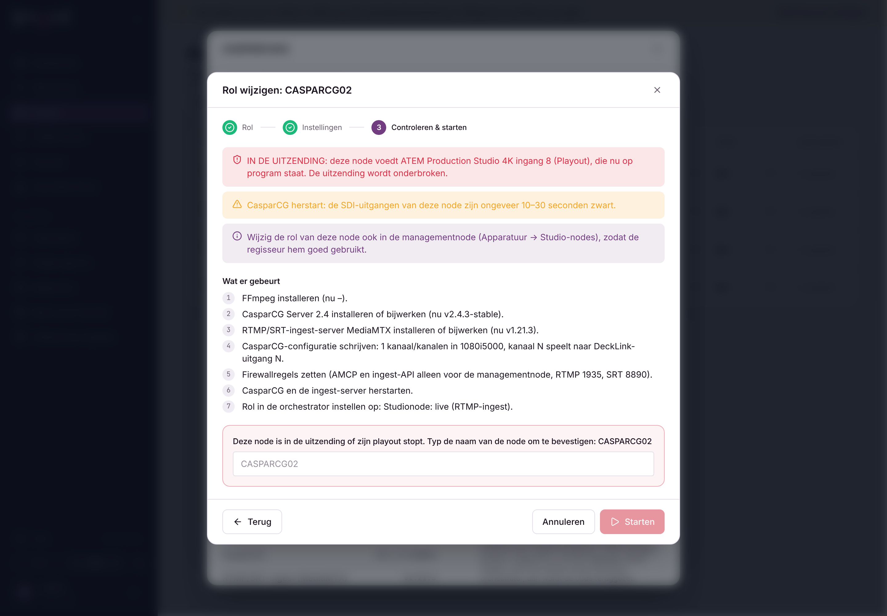

# Node agent: self-update and roles from the orchestrator

The agent on a node now updates itself and can turn a Windows node into a TV node, an ingest node, both, or back
to "no studio role", on a command from the orchestrator. A bare Windows PC only needs the agent
(`install-agent.ps1`); everything else is installed from the orchestrator.

## Automatic agent updates

- **Nodes → Agent settings**: on/off for all agents, an update window (local time of the node, default 03:00–05:00,
  both empty = any time) and the location of the Desktop Video installer (see below).
- Per node: **Role & software → Update the agent automatically**.
- The orchestrator looks up the newest agent release of its update channel (GitHub, cached 30 min) and sends it in
  every heartbeat. The agent updates when that version is newer, it is inside the window, no setup job runs, and it
  did not try in the last hour. It never downgrades by itself.
- Only the agent restarts; CasparCG and MediaMTX keep running, so SDI outputs are not interrupted.
- Safety net (Windows, `update-agent.ps1`): the old agent is copied to `%ProgramData%\TVSM\agent\update\previous`.
  The new agent writes `health.json` after its first good heartbeat; if that does not appear within 3 minutes, the
  old version is put back. Log: `%ProgramData%\TVSM\agent\update\update.log`.

## Change role (provisioning)

Nodes → node → **Role & software → Change role** (admins, Windows nodes):

1. **Role**: TV node (playout), Ingest node (live), TV node + ingest, or No studio role.
2. **Settings**: DeckLink outputs, video mode, media share (+ user/password, sent once and removed from the
   orchestrator database after delivery), management node IP (prefilled from the node with role Management node;
   only that address may use AMCP 5250 and the ingest API), FFmpeg, DeckLink driver, restart when done.
3. **Check & start**: the orchestrator shows every step and every warning. Warnings:
   - **ON AIR** (red): an ATEM input on program is fed by this node (ATEM inventory, input → node). You must type the
     node name to start. Removing the studio role always needs the name too.
   - CasparCG restart (outputs black ~10–30 s), fewer outputs, other video mode, live streams in use, no DeckLink
     driver, restart planned, AMCP open to everyone without a management IP, change the role in the management node too.
   - Blocks: offline, not Windows, a job already running, share user without password, DeckLink driver without source.

The server checks the plan again when the job is queued (`POST /api/nodes/:id/provision`), so the typed name cannot
be skipped. An agent without the `provision` capability gets an `update-agent` command first; the job waits in the
queue until the updated agent reports the capability. A queued job can be cancelled.

On the node the agent starts `provision.ps1` as a one-off scheduled task (SYSTEM, `tvsm-provision`), so it survives an
agent restart. Files in `%ProgramData%\TVSM\agent\provision`: `payload.json`, `status.json` (progress, reported in each
heartbeat), `provision.log`. Steps:

| Step | What |
| --- | --- |
| vcredist | Microsoft Visual C++ runtime (aka.ms/vs/17/release/vc_redist.x64.exe, Authenticode signature checked) |
| decklink | Blackmagic Desktop Video from the configured https URL or UNC path (.zip or .msi). The msi must be validly signed by Blackmagic; that certificate is added to Trusted Publishers so the driver installs silently. CasparCG stops; a restart is needed. A UNC path is read with the stored media share login. |
| ffmpeg | BtbN FFmpeg GPL release build, SHA-256 checked, to `%ProgramFiles%\TVSM\ffmpeg`, added to the machine PATH |
| studio | `install-studio.ps1 -SkipAgent -NonInteractive` with the role and settings (CasparCG 2.4, MediaMTX, casparcg.config, share, firewall) |
| disable | role "none": stop + disable tvsm-casparcg/tvsm-ingest, disable their firewall rules, park `studio.json` as `studio.json.disabled` (restored when a role is chosen again) |
| reboot | `shutdown /r /t 60` after reporting the result |

When the job is done the node's role in the orchestrator follows (playout/live/studio, "other" for no studio role)
and a mail alert is sent. A job that has not reported for 2 minutes while its task is gone, or runs longer than
3 hours, is reported as failed with the last log lines.

Blackmagic does not offer a stable public download link: download Desktop Video once from
blackmagicdesign.com/support and put it on the share (or an internal https server).

## Inventory

Every 10 minutes the agent runs `inventory.ps1` (read-only) and reports: Windows version, Desktop Video version,
DeckLink devices, GPU + driver, FFmpeg, VC++ runtime, CasparCG, MediaMTX, stored share login, pending restart.
Shown under **Role & software** and used by the plan.

## Notes

- `install-studio.ps1` now stores `-ManagementHost` in `studio.json` and reuses it on a rerun.
- The management node's own studio-node role (Devices → Studio nodes) is not changed automatically.
- PowerShell scripts were not run on a real machine before this release; test on a node that is not on air first.
