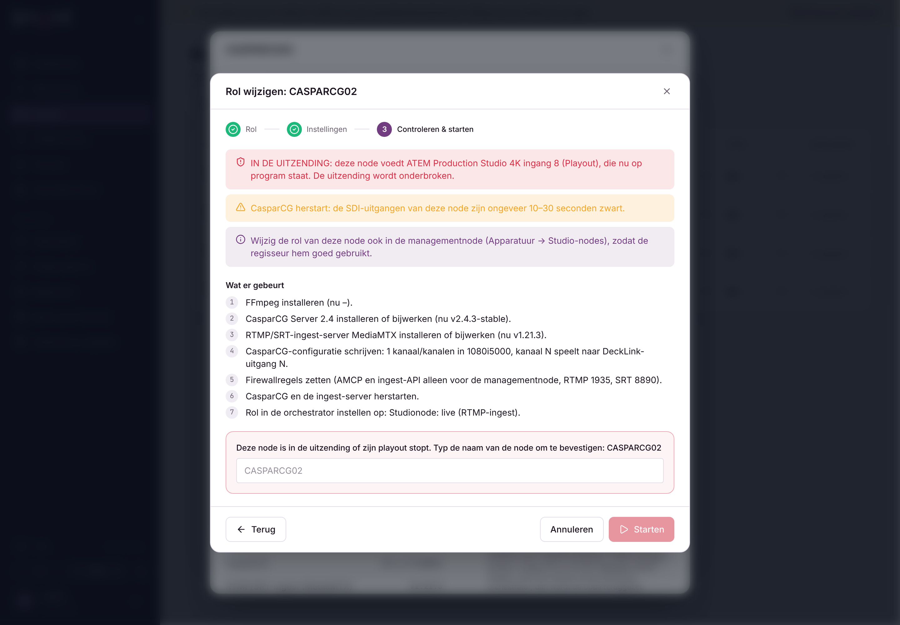

# Node-agent: zelf bijwerken en rollen vanuit de orchestrator

De agent op een node werkt zichzelf nu bij en kan een Windows-node ombouwen tot tv-node, ingest-node, beide, of
terug naar "geen studiorol", op een opdracht van de orchestrator. Een kale Windows-pc heeft alleen de agent nodig
(`install-agent.ps1`); de rest installeer je vanuit de orchestrator.



## Automatisch bijwerken

- **Nodes → Agentinstellingen**: aan/uit voor alle agents, updatevenster (lokale tijd van de node, standaard
  03:00–05:00, beide leeg = altijd) en de locatie van de Desktop Video-installer.
- Per node: **Rol & software → Agent automatisch bijwerken**.
- De orchestrator zoekt de nieuwste agentversie van zijn updatekanaal op en geeft die mee in elke heartbeat. De agent
  werkt bij als die nieuwer is, binnen het venster, zonder lopende inrichting, maximaal één poging per uur, nooit
  terug naar een oudere versie.
- Alleen de agent herstart; CasparCG en MediaMTX blijven draaien, de SDI-uitgangen dus ook.
- Vangnet: de oude agent wordt bewaard; meldt de nieuwe zich niet binnen 3 minuten bij de orchestrator
  (`health.json`), dan wordt de oude teruggezet. Log: `%ProgramData%\TVSM\agent\update\update.log`.

## Rol wijzigen

Nodes → node → **Rol & software → Rol wijzigen** (beheerders, Windows-nodes), in drie stappen: rol kiezen,
instellingen + software, controleren & starten. De controlestap toont elke stap en elke waarschuwing:

- **IN DE UITZENDING** (rood): een ATEM-ingang op program wordt door deze node gevoed. Je moet de naam van de node
  typen om te starten. Ook bij "geen studiorol" moet je de naam typen.
- CasparCG-herstart (uitgangen ~10–30 s zwart), minder uitgangen, ander videoformaat, livestreams in gebruik,
  geen DeckLink-driver, herstart gepland, AMCP open zonder management-IP, rol ook in de managementnode wijzigen.
- Blokkades: offline, geen Windows, al een inrichting bezig, share-gebruiker zonder wachtwoord, DeckLink-driver
  zonder bron.

De server controleert het plan opnieuw bij het starten. Een oude agent werkt zichzelf eerst bij; de opdracht wacht
tot dat klaar is. Het share-wachtwoord gaat één keer naar de node en wordt daarna uit de database gehaald.

Op de node draait `provision.ps1` als eenmalige geplande taak (SYSTEM): Visual C++-runtime, DeckLink-driver (Desktop
Video, handtekening van Blackmagic gecontroleerd), FFmpeg (BtbN GPL-build, checksum gecontroleerd), daarna
`install-studio.ps1` met de rol, of bij "geen studiorol" diensten stoppen en uitschakelen. Voortgang en log in
`%ProgramData%\TVSM\agent\provision`. Als het klaar is volgt de rol in de orchestrator en gaat er een mail.

Blackmagic heeft geen vaste downloadlink: download Desktop Video één keer van blackmagicdesign.com/support en zet het
op de share (of een interne https-server).

## Bureaubladachtergrond

Elke studionode krijgt een rustige achtergrond in de huisstijl die laat zien wat de machine doet: naam, rol
(playout, live / ingest of beide) met uitleg, IP-adres, de CasparCG-kanalen en DeckLink-uitgangen, de status van
tvsm-agent / tvsm-casparcg / tvsm-ingest, CPU, geheugen en schijf C:, agentversie en hoe lang hij aanstaat.
`install-studio.ps1` maakt de taak **TVSM Desktop Info** aan (elke 5 minuten en bij aanmelden, onzichtbaar). Het script
leest alleen en komt niet aan diensten.

Op een bestaande node zonder herinstallatie:

```powershell
& "C:\Program Files\TVSM\agent\studio\desktop-info.ps1" -Install -Language nl -Description "Playout - kanaal 2 + stream2"
```

Met `-Uninstall` haal je de taak weer weg.

Zie [agent-provisioning.md](agent-provisioning.md) voor alle details.
