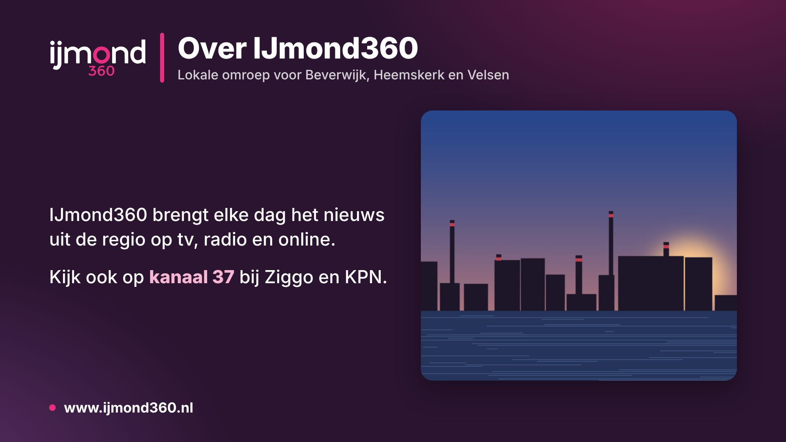

# Info pages

Fixed full-screen pages with information for viewers, such as contact details or information about the station.
Editors make them under **Setup → Sources → Info pages** and place them in an hour block like a clip.

## Making a page

- **Layout**: text only, picture right, picture left, picture behind the text, or picture only (a slide designed elsewhere).
- **Heading**, **line under the heading**, **text** and **bottom line**. In the text an empty line starts a new
  paragraph, a line starting with `- ` is a list item and `**word**` is bold. Less text gets bigger letters.
- **Picture**: PNG, JPEG or WebP. The browser makes large pictures full HD before uploading.
- **Length on air**: the default length wherever the page is placed. A block item can still set its own length.
- **Channel logo in the heading** and **keep logo, clock and ticker on top** (off by default, like the beeldkrant;
  the layer rule "Info page" on Channel & layers applies otherwise).

Colours, logo and language come from the channel's coming-up slide settings, so all full-screen pages of a channel
share the house style. The preview in the editor shows unsaved changes straight away.

## In an hour block

- Library tab **Info** (drag or +), or the list **More…** in the block editor.
- Block item type `info` (`block_items.info_page_id`). Like a webcam, every page has its own one-item block
  (genre `info`, hidden from the Blocks list) so it can be dragged into the week or a rundown too.
- The director plays `/infopage/page.html?id=<id>&channel=<channel>` with the CasparCG HTML producer on the playout
  layer; the picture is served from `/infopage/img/<id>`. Pictures live in `<dataDir>/infopages` (part of backups).

Code: `apps/management/server/infopagelogic.ts` (pure: settings, text, HTML), `infopages.ts` (API and public page),
`infopagedb.ts`, UI `web/pages/InfoPages.tsx`.
