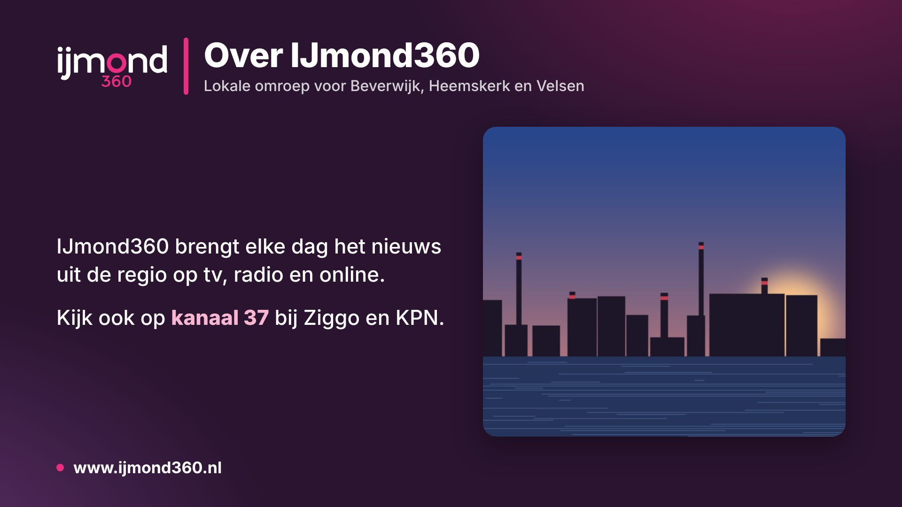

# Infopagina's

Vaste schermvullende pagina's met informatie voor kijkers, zoals contactgegevens of informatie over de zender.
Redacteuren maken ze onder **Inrichting → Bronnen → Infopagina's** en zetten ze in een uurblok, net als een clip.

## Een pagina maken

- **Indeling**: alleen tekst, foto rechts, foto links, foto achter de tekst, of alleen een foto (een elders ontworpen slide).
- **Kop**, **regel onder de kop**, **tekst** en **onderregel**. In de tekst begint een lege regel een nieuwe alinea,
  een regel die begint met `- ` wordt een opsomming en `**woord**` wordt vet. Minder tekst krijgt grotere letters.
- **Afbeelding**: PNG, JPEG of WebP. Grote foto's worden vóór het uploaden full HD gemaakt.
- **Duur in beeld**: de standaardduur overal waar de pagina staat. Een item in een blok kan een eigen duur krijgen.
- **Kanaallogo bij de kop** en **logo, klok en ticker erover laten staan** (standaard uit, net als bij de beeldkrant;
  anders geldt de laagregel "Infopagina" bij Kanaal & lagen).

Kleuren, logo en taal komen van de Straks-slide-instellingen van het kanaal, zodat alle schermvullende pagina's dezelfde
huisstijl hebben. Het voorbeeld in de editor laat wijzigingen meteen zien, ook voordat je opslaat.

## In een uurblok

- Bibliotheek-tab **Info** (slepen of +), of de lijst **Meer…** in het blok.
- Elke pagina heeft ook een eigen blok, zodat je hem ook in de weekplanning kunt slepen.
- Op tv speelt CasparCG de pagina af als webpagina (HTML-producer) op de playout-laag.
