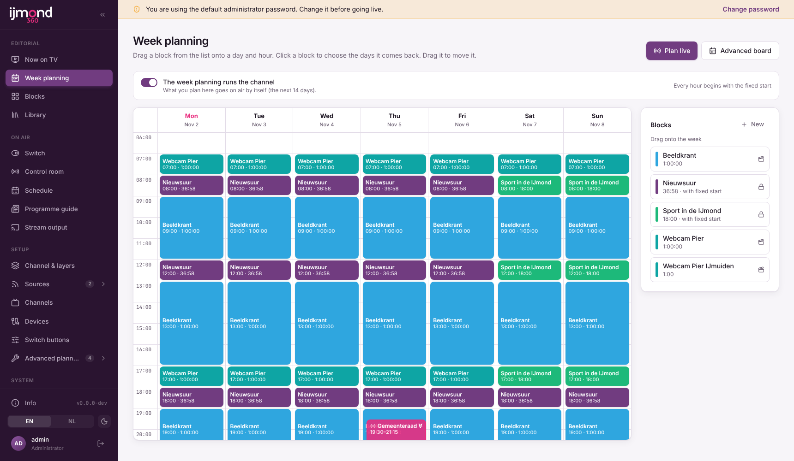
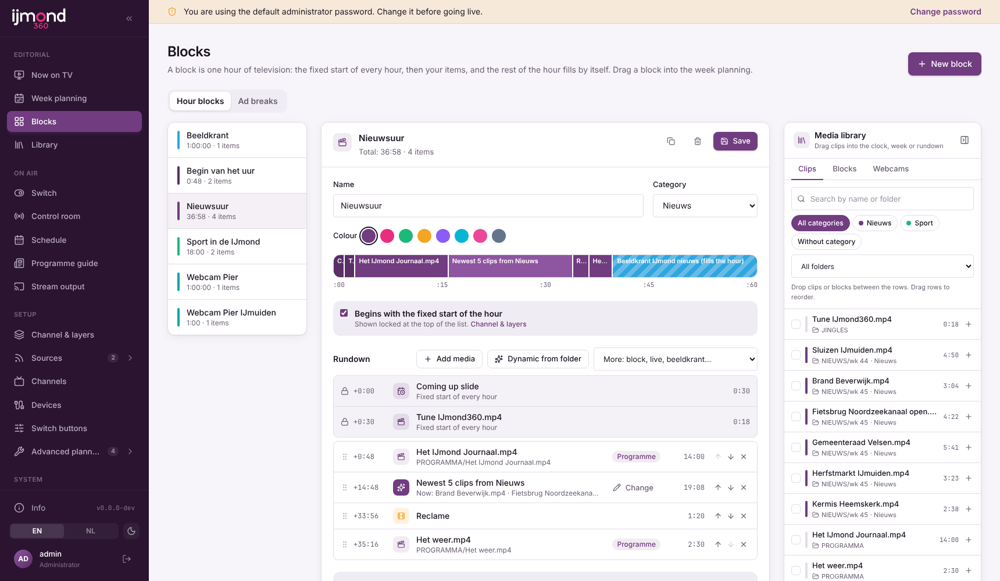
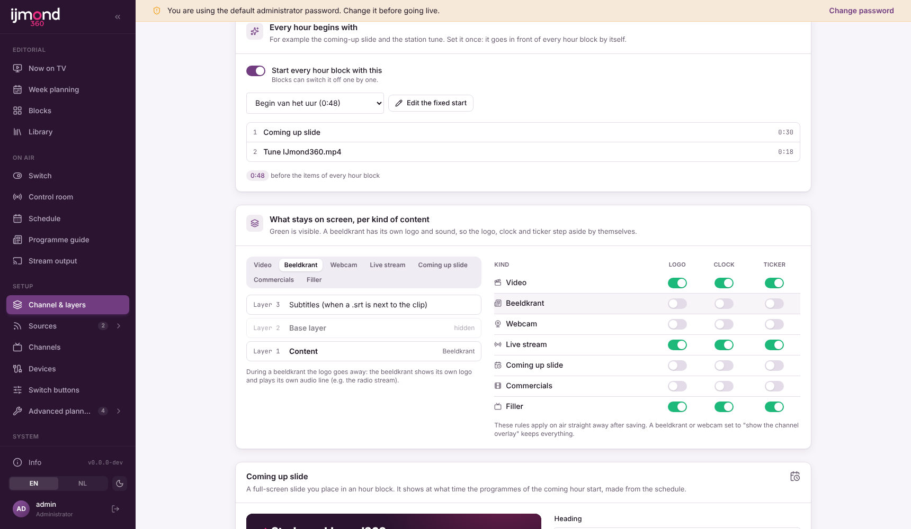

# Simple planning: hour blocks in a week

Editors plan the channel with three ideas. The older tools (hour clocks, day planning, the advanced week board and the
*New hour programme* wizard) still work and are under **Setup → Advanced planning** for admins.

| Menu | What it is |
| --- | --- |
| **Editorial → Library** | Everything that can go on air, one page with tabs: Videos, Recordings, Beeldkranten, Webcams, Live. |
| **Editorial → Blocks** | An hour block: the fixed start of the hour, your items, and what fills the rest of the hour. Ad breaks are the second tab. |
| **Editorial → Week planning** | Drag blocks onto a week of hours; click a block to pick its days. *Plan live* puts a live event over it. |
| **Setup → Channel & layers** | Logo, clock, ticker; what stays on screen per kind of content; what every hour begins with. |

## A block is one hour

1. **Fixed start** (locked rows at the top): the block set under *Channel & layers → Every hour begins with*, for
   example the coming-up slide and the station tune. It goes in front of every hour block by itself
   (`blocks.hour_start`, on for new programme blocks; a block can switch it off). The fixed start is not added to parts
   of an hour clock (entries with `skip/take`) or to the fixed-start block itself.
2. **Items**: videos, *Dynamic from folder* (newest / in turn / random; picked again for every broadcast, so a clip
   that lands on the UNAS at 08:31 plays at 09:00 and the oldest drops out), ad breaks, beeldkrant, webcam, live.
3. **Fill the rest of the hour** with a beeldkrant or webcam (see [week-schedule.md](week-schedule.md)). At :00 the
   next block starts, again with the fixed start.

The hour bar above the list shows all three. Items that hide the logo on air are marked *logo off*.

## Week planning

- Drag a block from the list on the right onto a day and hour: a week slot (`clock_mode = 'none'`, 60 minutes) on that
  weekday. Drag a block in the grid to move it; pull its bottom edge to make it longer or shorter (whole hours, up to the
  next block or midnight; every day of the series follows).
- Click a block: the day buttons switch the series on and off (same time, same block; `/api/week/slots/:id/series`),
  the length can be 1, 2 or 3 hours, *Only <date>* opens the rundown of that one date.
- Slots made with a clock or category on the advanced board show here too, and are edited there.
- **Plan live**: a live source, a day, a start and an end time. It becomes a manual schedule entry with a hidden block
  that holds the live source for exactly that time. Manual entries go over the week planning; after the end the
  planning carries on. The live event shows in pink over the week and can be removed with its ×.

## Channel & layers

A channel is a stack: content at the bottom (layer 1), the base layer with logo, clock and ticker on top (layer 2),
subtitles above that. Per kind of content (video, beeldkrant, webcam, live stream, coming-up slide, commercials,
filler) three switches decide whether the logo, clock and ticker stay on air. Defaults keep the old behaviour: a
beeldkrant, webcam, coming-up slide or commercial hides the base layer; a beeldkrant brings its own logo and audio line.
A beeldkrant or webcam with *show the channel overlay* keeps everything.

Stored in the channel's graphics JSON: `layers` (`server/layers.ts`, pure: `layersSchema`, `layerKind`, `baseLayer`)
and `hourStart: { enabled, blockId }`. The director applies the rule per on-air event in `graphicsData`.

## Missing files

When a clip's file is no longer on the share (moved or renamed after the library scan), CasparCG cannot play it. The director tries for 10 seconds, then skips the clip: the rest of the programme moves up and the block's "rest of the hour" choice (or the channel filler) fills the freed time, so the next programme still starts on its own time. The skip is logged in the as-run log ("Skipped: file not found") and mailed as a playout alert.
