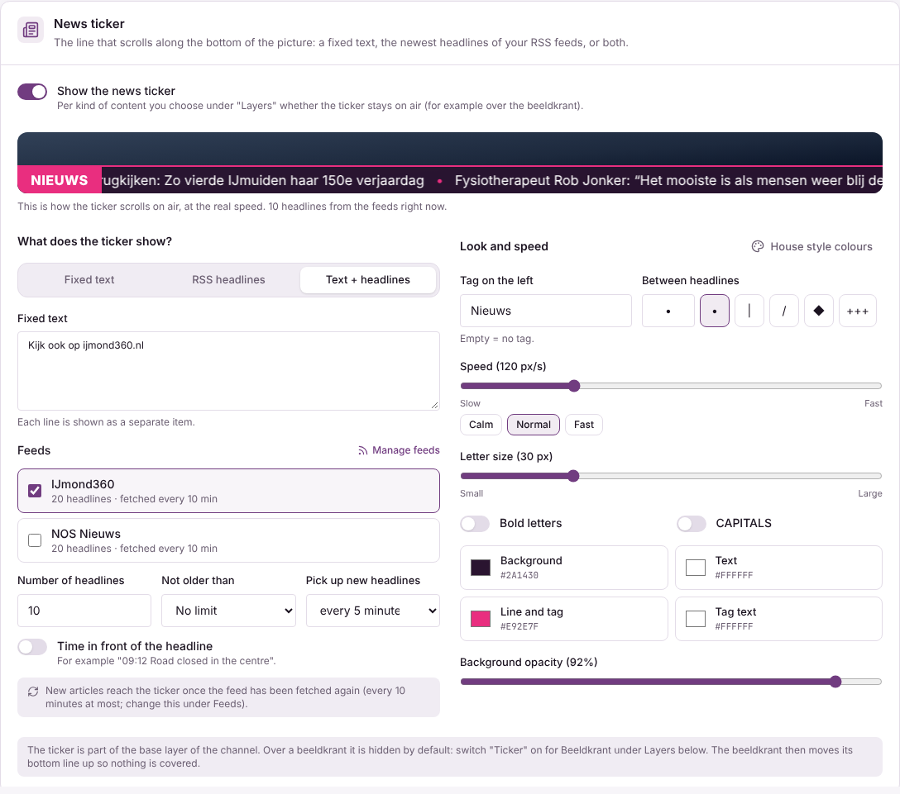
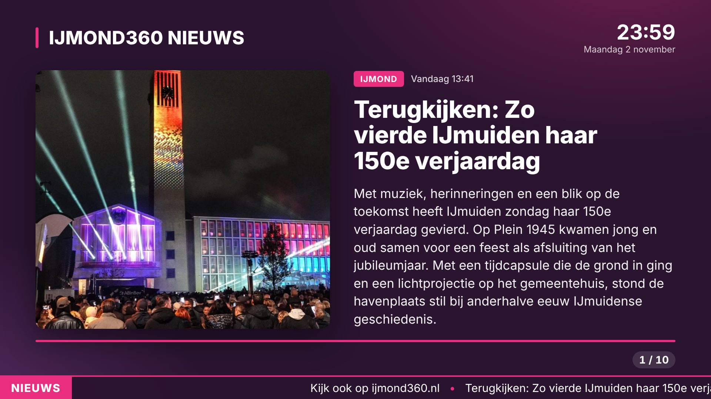

# News ticker

The news ticker is the line that scrolls along the bottom of the picture. It is part of the channel's base layer
(with the logo and the clock) and is set per channel on **Setup > Channel & layers**, card **News ticker**.

## What it shows

- **Fixed text**: every line of the text is a separate item.
- **RSS headlines**: the newest headlines of one or more feeds. The feeds are the same ones as for the beeldkrant
  (**Beeldkrant > Feeds**); add or change a feed there.
- **Text + headlines**: the fixed text first, then the headlines.

For headlines you choose the number of headlines, how old they may be, whether the time is put in front
("09:12 Road closed") and how often the ticker picks up new headlines (1 to 60 minutes). The ticker keeps its line
for that time, so it does not change on every fetch. New articles arrive once the feed itself has been fetched again
(the feed's own interval, on the Feeds tab). A feed that is switched off gives no headlines; with nothing to show the
bar stays away.

## Look and speed

Tag on the left (e.g. "NEWS", empty = none), separator between the headlines, speed in pixels per second (the picture
is 1920 px wide: 120 px/s crosses the screen in 16 s), letter size (the bar's height follows it), bold, capitals,
colours of background, text, line/tag and tag text, and the background opacity. **House style colours** puts the
colours of the active house style back. The preview at the top of the card scrolls at the real speed with the
real headlines.

## Over the beeldkrant

By default the ticker is hidden during a beeldkrant. Switch **Ticker** on for **Beeldkrant** in the card **Layers**
to keep it. The director then plays the beeldkrant page with `&ticker=<height>`: its page number, progress bar and
text move up so the ticker covers nothing.

## Technical

- Settings: `graphics.ticker` of the channel (`tickerSchema` in `apps/management/server/tickerlogic.ts`; older
  settings with only `enabled`/`text` keep working as a fixed text).
- `tickerlogic.ts` is pure (headlines, items, bar height, overlay data); `tickerdb.ts` reads the headlines from
  `rss_items`. The director caches them per channel for `refreshMinutes`.
- The overlay (`studio/casparcg-templates/tvsm/overlay.html`) gets `ticker { enabled, items[], separator, label,
  speed, fontSize, height, bold, uppercase, colors, backgroundOpacity }` and scrolls a queue of pieces: new headlines
  start with the next piece, so the line never jumps. The speed is time based (px/s), not per frame.
- Preview: `POST /api/ticker/preview` with the ticker settings returns `{ items, headlines, height }`.
