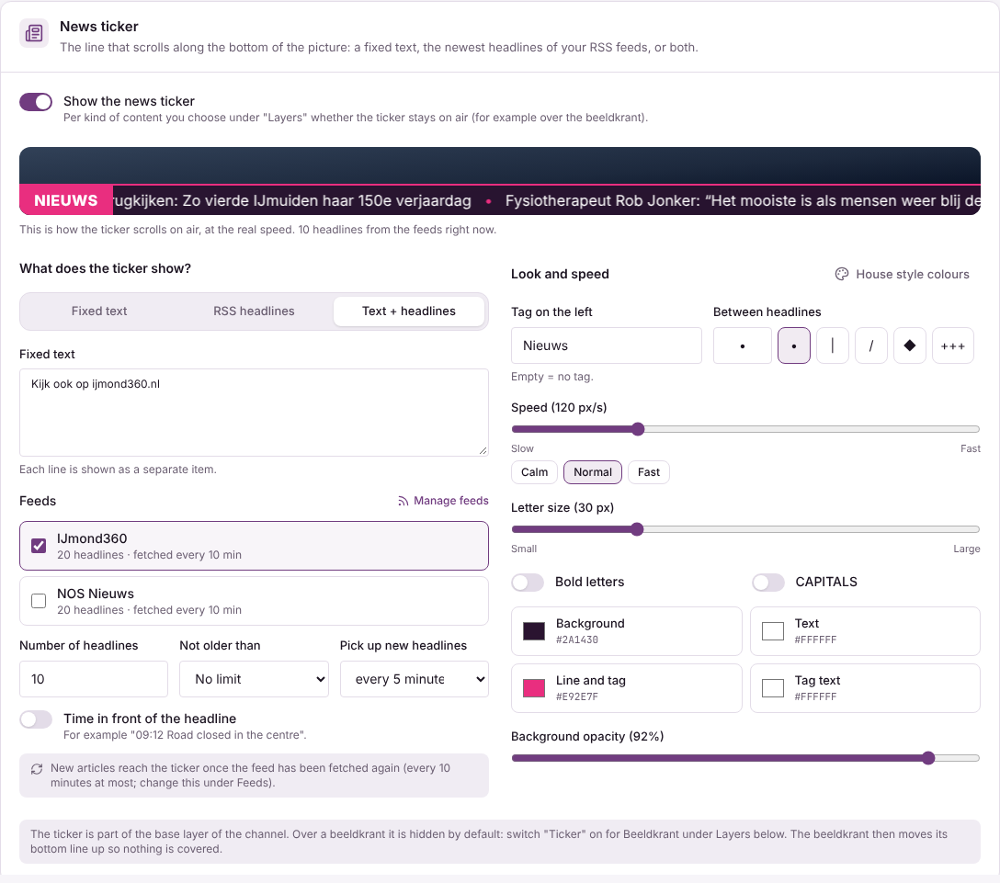
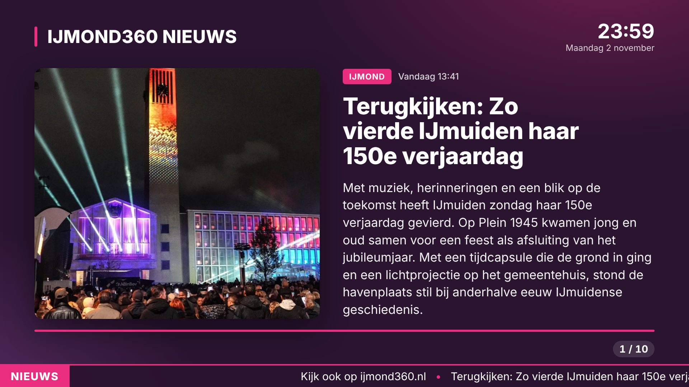

# Nieuwsticker

De nieuwsticker is de regel die onderin het beeld voorbij loopt. Hij hoort bij de basislaag van het kanaal (met het
logo en de klok) en stel je per kanaal in bij **Instellingen > Kanaal & lagen**, kaart **Nieuwsticker**.

## Wat hij laat zien

- **Vaste tekst**: elke regel van de tekst komt als los item voorbij.
- **RSS-koppen**: de nieuwste koppen van een of meer feeds. Dat zijn dezelfde feeds als voor de beeldkrant
  (**Beeldkrant > Feeds**); daar voeg je een feed toe of pas je hem aan.
- **Tekst + koppen**: eerst de vaste tekst, dan de koppen.

Bij koppen kies je het aantal, hoe oud ze mogen zijn, of de tijd ervoor staat ("09:12 Weg afgesloten") en hoe vaak de
ticker nieuwe koppen oppakt (1 tot 60 minuten). Zo lang houdt de ticker zijn regel vast, zodat hij niet bij elke
keer ophalen verspringt. Nieuwe artikelen komen binnen zodra de feed zelf opnieuw is opgehaald (de tijd van de feed, op
het tabblad Feeds). Een uitgeschakelde feed geeft geen koppen; is er niets te tonen, dan blijft de balk weg.

## Uiterlijk en snelheid

Label links (bijv. "NIEUWS", leeg = geen), teken tussen de koppen, snelheid in pixels per seconde (het beeld is
1920 px breed: met 120 px/s gaat een kop in 16 s over het scherm), lettergrootte (de hoogte van de balk gaat mee),
vet, hoofdletters, de kleuren van achtergrond, tekst, lijn/label en labeltekst, en hoe doorzichtig de achtergrond is.
**Huisstijlkleuren** zet de kleuren van de actieve huisstijl terug. Het voorbeeld bovenaan de kaart loopt op de
echte snelheid met de echte koppen.

## Over de beeldkrant

Standaard staat de ticker uit tijdens een beeldkrant. Zet bij de kaart **Lagen** **Ticker** aan voor **Beeldkrant**
om hem te houden. De regisseur speelt de beeldkrantpagina dan met `&ticker=<hoogte>`: paginanummer, voortgangsbalk en
tekst schuiven omhoog, zodat de ticker niets afdekt.

## Techniek

Zie de [Engelse versie](ticker.md#technical).
